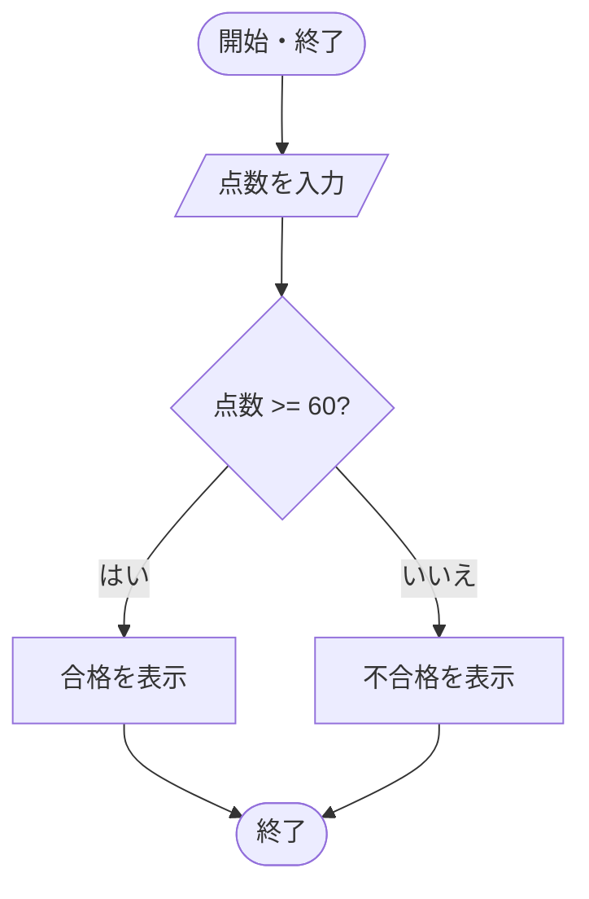

# 第2章・第3話　分岐と繰返し・流れ図――手順の道筋を三つの形で表す

プログラム全体の処理の流れは、順次、選択、繰返しという三つの基本形を組み合わせて構築できます。
順次は上から順に処理を実行し、選択は条件に応じて進路を分岐させ、繰返しは指定の条件が満たされる間同じ処理を繰り返す構造です。
これらは、構造化プログラミングにおける基本制御構造と呼ばれます。

条件分岐を細かく定義するほど、多様で複雑な入力データに柔軟に対応可能です。
一方で、複数の条件が同時に重なるケースや、どの条件にも合致しない境界条件を事前に検証しておく必要があります。
また繰返し処理においては、繰り返す処理本体の範囲に加えて、ループがどの時点で正常終了するかを厳密に定めなければなりません。
同じアルゴリズムであっても文章、擬似コード、流れ図、決定表といった異なる形式で表現し、条件判定と実行順序の妥当性を確かめる姿勢が大切です。

## 値の依存関係と、条件による選択

### 1 順次――前の結果を次へ渡す

```text
price = 1000
tax = price * 0.1
total = price + tax
```

まず価格を変数に格納し、その値をもとに税額を計算し、最後に税込合計金額を求めます。
上から1文ずつ順次実行されるため、前の処理結果を直後の文が参照する依存関係です。

```text
開始
 ↓
priceへ1000
 ↓
taxを計算
 ↓
totalを計算
 ↓
終了
```

命令の記述順を誤って入れ替えてしまうと、未初期化の変数を参照するバグにつながります。
したがって、常にデータの依存関係を意識して処理順序を設計する姿勢が不可欠です。

### 2 if文――条件が真のときだけ行う

```text
もし temperature > 30 なら
    "暑い"を表示する
```

無条件に実行する処理とは対照的に、特定の条件が成立したときのみ実行する分岐処理にはif文を用います。
この具体例では、条件式`temperature>30`の真偽を評価する仕組みです。

- 真なら、字下げされたブロックの文を実行。
- 偽なら、そのブロックをスキップ。

30度ちょうどを対象に含むかどうかは、比較演算子が`>`か`>=`かによって結果が異なります。

### 3 if-else――二つの道から一つを選ぶ

```text
もし score >= 60 なら
    result = "合格"
そうでなければ
    result = "不合格"
```

条件が偽となった場合の処理も明示的に定義すれば、2本の実行経路のうちいずれか一方のみを確実に通過する仕組みです。

| score | `score>=60` | result |
|---:|---|---|
| 59 | 偽 | 不合格 |
| 60 | 真 | 合格 |

境界値となる59、60、61の入力をテストケースとして検証すると、比較演算子の境界誤りを容易に検知できます。

### 4 else-if――三つ以上に分ける

点数データを三つ以上の評価区分へ振り分ける場面では、条件式を評価する順序自体が実行結果を大きく左右する要因です。
評価順において最初に真となった分岐ブロックのみが実行されるため、広い条件を上流に置くと狭い条件ブロックへ制御が到達しません。

具体例として点数を成績区分へ変換してみましょう。

```text
もし score >= 80 なら
    grade = "A"
そうでなく score >= 60 なら
    grade = "B"
そうでなければ
    grade = "C"
```

処理系は上から順に各条件を評価していき、最初に真となった枝の処理だけを実行します。

もし次の順序で記述してしまうと、90点であっても最初の`>=60`が真となるため評価Bとなり、Aの枝に到達しなくなるため注意が必要です。

```text
もし score >= 60 なら B
そうでなく score >= 80 なら A
```


### 5 条件の重なりと漏れ

年齢情報を次のような区分に分類する場合にも、判定条件の境界値を厳密に点検します。

```text
0～12 子ども
13～17 未成年
18以上 成人
```

設計する条件群は、次の二つの要件を同時に満たすことが不可欠です。

- 重なり合わない（排他的である）。
- 想定される入力範囲全体を漏れなく網羅する。

負の年齢値や数値以外の不正な入力が渡された際にどう対処するかという例外仕様も欠かせません。

### 6 ネスト――分岐の中に分岐を置く

```text
もし userExists なら
    もし passwordCorrect なら
        login = true
    そうでなければ
        login = false
    そうでなければ
        login = false
```

分岐のブロック内に別の分岐構造を入れ子にして配置する記法をネストと呼びます。

過度に深いネストはコードの可読性を損ねるため、次のような設計で浅く保つ工夫が有効です。

- ガード節を用いて早期リターンを行う。
- 複合条件を独立した関数として切り出す。
- 同一の結果をもたらす枝を論理演算子で結合する。

## 繰り返す範囲と、条件を調べる時点

### 7 while――条件が真の間、繰り返す

判定条件が真の間、同一の処理ブロックを反復実行する構文がwhile文です。
次のコード例では、カウンタを用いて1から5までの数値を順次出力します。

```text
i = 1
while i <= 5
    iを表示する
    i = i + 1
```

ループの実行を追跡する際は、条件を判定する時点の値と、本体処理実行後の変数値の変化を段階的に整理することが肝要です。

| 回 | 条件を調べる時のi | 条件 | 表示 | 更新後i |
|---:|---:|---|---:|---:|
| 1 | 1 | 真 | 1 | 2 |
| 2 | 2 | 真 | 2 | 3 |
| 3 | 3 | 真 | 3 | 4 |
| 4 | 4 | 真 | 4 | 5 |
| 5 | 5 | 真 | 5 | 6 |
| 終了 | 6 | 偽 | なし | 6 |


### 8 ループの四つの部品

カウンタ変数を利用するループ処理では、次の4要素が正しく機能しているかを確認します。

1. `i=1`で初期化する。
2. `i<=5`なら継続する。
3. 本体で表示などを行う。
4. `i=i+1`で更新する。

カウンタ変数の更新処理を忘れてしまうと`i`の値が1に固定され、条件が恒真となって無限ループに陥る点に注意が必要です。

### 9 for――回数や要素が分かる繰返し

あらかじめ実行回数が定まっている処理では、次のようにfor文を用いると構造を簡潔に表現できます。

```text
for i = 1 から 5 まで
    iを表示する
```

コレクション内の各要素を順番に取り出して処理したい場合にも、簡潔な反復構文が利用可能です。

```text
for each name in names
    nameを表示する
```

何回繰り返すか、あるいはどの集合要素を順次走査するかが自明な場面に適しています。

なお「1から5まで」という範囲指定が終了値5を含むか否かは、言語仕様や擬似コードの定義を確認しなければなりません。

### 10 前判定と後判定

反復条件そのものが同一であっても、処理本体の実行前と実行後のどちらで評価するかによって、最小実行回数の保証が変化します。

#### 前判定

処理本体を実行する前に継続条件を判定する方式です。
初回の判定で偽となれば、ループ本体の実行回数は0回です。

```text
while 条件
    本体
```


#### 後判定

本体処理を最低1回実行した後に継続条件を判定します。
そのため、必ず1回以上はループ本体が実行される構造です。

```text
do
    本体
while 条件
```

利用者にまず1回は入力を求め、その後に処理を継続するか確認するような対話的処理で活用されます。

## 集計する値と、空入力の扱い

### 11 番兵値――特別な入力で終える

入力される点数データの総数が事前に決まっておらず、`-1`が入力された時点で集計を終了するケースを考えてみましょう。

```text
total = 0
count = 0
scoreを入力
while score != -1
    total = total + score
    count = count + 1
    scoreを入力
```

このように入力終了の合図として予約された特殊な値を番兵値（sentinel value）と呼びます。

この手法は、正常な入力データの中に`-1`が決して現れないことが大前提です。
あらゆる数値が有効データとなり得る仕様であれば、別の終了シグナルや入力終了判定を用います。

### 12 合計、件数、最大値の型

集計処理に用いる変数の初期値は、求める統計量の性質に応じて適切に設定しなければなりません。
合計や件数であれば初期値0が適しますが、最大値の初期値まで0にしてしまうと、すべての入力が負値であった場合に誤って0を出力してしまう結果となるわけです。

#### 合計

```text
total = 0
各valueについて
    total = total + value
```

加算処理の単位元である0を変数の初期値に設定します。

#### 件数

```text
count = 0
条件に合うたび
    count = count + 1
```


#### 最大値

```text
maxValue = 最初の要素
二番目以降の各valueについて
    もし value > maxValue なら
        maxValue = value
```

初期値を安易に0に設定すると、全データが負値のケースで存在しない0が最大値として誤認されます。
したがって、最初の要素の値で初期化するか、未初期化状態を明示的に判定する設計が重要です。

### 13 0回の入力を考える

典型的な繰返し処理の例題では、1回以上の反復実行を前提とした解説が目立ちます。
しかし前判定ループにおいては、初回の条件判定が偽であれば本体処理は1度も実行されません。
空の入力データが与えられる状況は、ループ構造が正常に処理し得る標準的な入力状態の一つです。

平均値を計算する処理においても、除算を行う前にデータ件数が0でないことを確実に点検します。

```text
average = total / count
```

もしデータ件数が0のままこの式を実行すれば、致命的な0除算エラーが発生する危険に留意が必要です。

```text
もし count > 0 なら
    average = total / count
そうでなければ
    データなしとして扱う
```

要素数が0の空入力パターンは、あらゆるアルゴリズム設計において最も基本的な境界条件です。

## 境界と、途中から移る制御

### 14 off-by-oneエラー

境界値の指定が1つずれることによって発生する典型的なバグをoff-by-oneエラーと呼びます。

データ要素が5個存在しインデックスが0から4までである場合、走査すべき添字は次の範囲です。

```text
i=0,1,2,3,4
```

ここで継続条件を誤って`i<=5`に設定すると、存在しない添字5の領域へアクセスしてしまいます。
正しくは継続条件として`i<5`を指定しなければなりません。

要素数、末尾の添字、継続条件の整合性は次のように整理できます。

```text
要素数n
0開始なら最後はn-1
条件はi<n
```


### 15 breakとcontinue

ループ本体の実行途中で制御の流れを変更する制御文では、ループ全体を脱出するか、当該回の処理のみをスキップするかを明確に区別します。
`break`はループそのものを中断して終了させ、`continue`は現在の周回処理のみを打ち切って次の周回へ移行する命令です。

#### break

実行中のループ構造をその場で強制終了します。

#### continue

現在の周回の残余処理をスキップし、次のループ周回へ制御を進める働きです。

これらのジャンプ命令は便利である反面、多用すると制御の出入口が乱立して全体の追跡が困難になります。
多重ループ構造においては、どの階層のループから脱出するかという言語仕様の挙動にも配慮が必要です。

### 16 無限ループが必要な場合

ネットワークサーバや組込み制御プログラムでは、シャットダウン命令を受信するまで常時リクエストを監視し続ける構成が求められます。

```text
while true
    requestを待つ
    requestを処理する
```

意図して無限ループを構築する場合であっても、次のような運用上の境界設計を考慮しておくことが大切です。

- 外部からの終了要求シグナルをどのように検知するか。
- 内部エラーが発生した際にプロセスを継続するか停止するか。
- 使用中のリソースを正常に解放する経路が確保されているか。
- CPU使用率を無駄に占有しないための待機機構が組み込まれているか。

## 途中の正しさと、停止する理由

### 17 ループ不変条件

1から`n`までの総和を求める反復アルゴリズムを検証してみます。

```text
sum = 0
i = 1
while i <= n
    sum = sum + i
    i = i + 1
```

この処理において、各ループ周回の先頭時点では常に次の普遍的な関係式が成立している状態です。

```text
sumは1からi-1までの和である
```

- ループ開始時（`i=1`）では、1から0までの空の総和として0が成立。
- 各周回で`sum`に`i`を加算した後に`i`を1増加させるため、次の周回の先頭でも関係が維持。
- ループ終了時（`i=n+1`）には、`sum`が1から`n`までの完全な総和と一致。

このように各周回の境界で常に真に保たれる論理的関係を**ループ不変条件**と呼びます。
不変条件を立証することは、ループアルゴリズムの正当性を数学的に裏付ける強力な手段です。

### 18 停止性

前述の加算ループは、残り周回数を示す指標`n-i+1`が各周回で確実に1ずつ減少し、0以下に達した時点で必ず終了します。

アルゴリズムが無限ループに陥らず必ず停止することを証明するには、次の三点を確認することがポイントです。

- 毎回の反復によって単調に変化する離散的な変量が存在すること。
- その変量に対してこれ以上進めない明確な境界値が存在すること。
- 有限ステップの実行によって終了条件へ確実に到達すること。

## コードの分岐と繰返しを図に対応させる

### 19 流れ図の基本記号

流れ図（フローチャート）は、アルゴリズムの手順と分岐を視覚的な図形記号として表現します。

#### 端子

処理の開始および終了地点を表す角の丸い長方形です。

#### 処理

数値計算やデータ代入の操作を通常の長方形で表します。

#### 判断

条件判定による分岐を表す図形としてひし形記号を用います。
分岐する各経路の近傍に「真・偽」または「はい・いいえ」の判定ラベルを付記するルールです。

#### データ

外部からのデータ入力や画面出力を表現する平行四辺形記号です。

#### 定義済み処理

サブルーチンやモジュールの呼出しを左右二重線の長方形で示します。

#### ループ端

資格試験等の流れ図では、反復範囲の開始と終了を示す専用記号が用いられる場合があります。

#### 線

処理の実行順序を指し示す矢印付きの接続線です。
線の交差と分岐接続を取り違えないよう、明瞭な接続点記号を用いて図示します。

### 20 if文を流れ図へする

60点以上で合格、それ未満で不合格とする2分岐アルゴリズムを流れ図に対応づけて確認してみましょう。

```text
        開始
          ↓
    scoreを入力
          ↓
    <score>=60?>
      /           真         偽
    ↓          ↓
 合格を表示  不合格を表示
      \       /
          ↓
         終了
```

判断記号から分岐する各矢印に対して、判定の真偽条件を漏れなく記述します。

#### 標準流れ図記号の対応



端子には角の丸い開始・終了記号を割り当て、データの入出力には平行四辺形、個別処理には長方形、条件判断にはひし形を配置する構成です。
同一の処理ロジックを擬似コードで表記すると`入力→if 点数≥60 then 合格 else 不合格→終了`という流れです。

### 21 whileを流れ図へする

1から5までの数値を順次出力するwhileループも、条件判定と変数更新の連動を図として明確に追跡できます。

```text
開始
 ↓
i=1
 ↓
<i<=5?> ─偽→ 終了
  |
  真
  ↓
iを表示
  ↓
i=i+1
  └────→ 条件へ戻る
```

処理本体の末尾から先頭の判断記号へ戻るフィードバック経路の描画が不可欠です。

## 条件の組み合わせと、処理の漏れ

### 22 決定表――条件の組合せを漏れなく並べる

複雑に絡み合う条件の組み合わせを検証する際は、分岐図に加えてすべての組合せを行列形式で整理する決定表が威力を発揮します。
送料無料の適用判定を行う次の二条件を題材に整理してみましょう。

- 会員資格を有しているか。
- 購入総額が5000円以上であるか。

| 条件・動作 | 規則1 | 規則2 | 規則3 | 規則4 |
|---|---|---|---|---|
| 会員 | はい | はい | いいえ | いいえ |
| 5000円以上 | はい | いいえ | はい | いいえ |
| 送料無料 | 実行 | 実行 | 実行 | しない |

この設定例では、二条件のうちどちらか一方でも満たされていれば送料無料が適用されます。

決定表を活用すると、条件数の増加に伴って生じがちな判定パターンの見落としを確実に防止可能です。

### 23 条件数と規則数

互いに独立した真偽判定条件が`n`個存在する場合、取り得る全組み合わせは`2ⁿ`通りに達します。

条件が3個であれば8通り、4個であれば16通りの組み合わせが発生する計算です。

ただし業務上では同時に発生し得ない組み合わせや、結果が同一であるため集約可能なケースが多々存在します。
該当条件のセルにハイフン（無関係）を記入することで、表の構成の大幅な簡潔化が可能です。

安全設計に直結する重要な判定条件を安易に「どちらでもよい」として省略してはなりません。

真偽条件が1つの場合は`真,偽`の2通りで構成されます。
2つ目の条件を追加すると各ケースがさらに2分割されて4通り、3つ目で8通りへと指数関数的に増加していく計算です。
したがって、独立した真偽条件n個の組み合わせ総数は`2×2×…×2=2ⁿ`通りとして定式化されるわけです。

### 24 ガード節――異常条件を先に返す

異常系や境界条件を関数の冒頭で早期判定して即座に返却すると、主たる正常処理を浅い階層に配置できます。

```text
関数 withdraw(amount)
    もし amount <= 0 なら
        エラーを返す
    もし amount > balance なら
        残高不足を返す
    balance = balance - amount
    成功を返す
```

前提条件の逸脱を先頭で排除し、主要なロジックを平坦に記述する設計手法をガード節と呼ぶわけです。

### 25 制御構造を選ぶ問い

- 常に順次実行すべき処理であるか。
- 条件に応じて排他的に1つを選択するか。
- 反復回数が事前に確定しているか。
- 特定の停止条件に達するまで継続するか。
- 最低1回の実行が前提とされているか。
- 探索途中で目的の値を発見した際に早期脱出可能か。
- 入力要素が0件のケースが存在するか。
- 境界値を含む不等号判定となっているか。

プログラミング言語の構文を選ぶ前に、これらの観点を通じてロジックの流れを確定します。

点数の条件分岐では判定境界と評価順序の重要性を確認し、カウンタを用いた反復では初期化、更新、終了条件の整合性を確かめました。
順次、選択、繰返しという基本構造の性質を把握した上で、境界値を含むあらゆる入力を漏れなく処理し、確実に停止する論理を組み立てていく姿勢が大切です。
